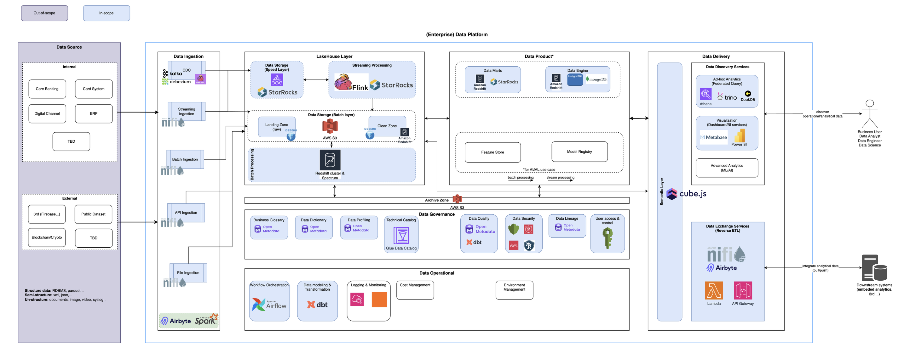
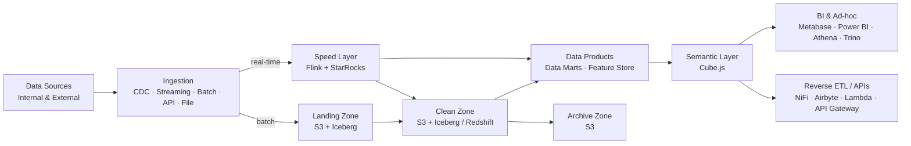

# Enterprise Data Platform – Lakehouse Architecture on AWS

## Overview

This project demonstrates an **Enterprise Data Platform** built on a **Lakehouse Architecture** for the banking domain. The platform unifies **Data Lake** and **Data Warehouse** capabilities to serve both **batch** and **real-time (streaming)** workloads, from raw data ingestion to governed **Data Products** and **self-service analytics**.

The platform is designed to be **scalable**, **cost-efficient**, **secure**, and **governed by design**, aligned with **DAMA-DMBOK** data management principles. It integrates key components including **CDC with Debezium/Kafka**, **Apache NiFi** for multi-mode ingestion, **Amazon S3 + Apache Iceberg** as the open table format, **Amazon Redshift** and **StarRocks** for analytical serving, **Apache Flink** for stream processing, **Cube.js** as the semantic layer, and **OpenMetadata** for data governance.

## Architecture Components

### 1. **Data Sources** *(out-of-scope)*
The platform ingests data from both internal and external sources:
- **Internal**: Core Banking, Card System, Digital Channel, ERP, and other line-of-business systems.
- **External**: 3rd-party platforms (e.g., Firebase), Public Datasets, Blockchain/Crypto data providers.
- **Data types supported**:
  - **Structured**: RDBMS tables, Parquet.
  - **Semi-structured**: XML, JSON.
  - **Unstructured**: documents, images, video, syslog.

### 2. **Data Ingestion Layer**
Supports multiple ingestion patterns depending on source characteristics and latency requirements:
- **CDC (Change Data Capture)**: **Debezium** and **Flink CDC** capture row-level changes from transactional databases and publish them to **Apache Kafka (Amazon MSK)**.
- **Streaming Ingestion**: **Apache NiFi** ingests continuous event streams (logs, clickstream, app events).
- **Batch Ingestion**: **Apache NiFi** handles scheduled bulk extracts from RDBMS and file-based systems.
- **API Ingestion**: **Apache NiFi** pulls data from REST/SOAP APIs of internal and external partners.
- **File Ingestion**: **Apache NiFi** collects files (CSV, XML, JSON, Parquet, documents) from SFTP/shared storage.
- **Connector-based & distributed processing**: **Airbyte** for SaaS/3rd-party connectors and **Apache Spark** for large-scale extraction and pre-processing.

### 3. **Lakehouse Layer**
A hybrid architecture combining a **Speed Layer** and a **Batch Layer** (Lambda-style) on top of open storage:

#### 3.1 Speed Layer (Real-time)
- **Data Storage (Speed Layer)**: **StarRocks** stores real-time data for low-latency analytical queries.
- **Streaming Processing**: **Apache Flink** performs stateful stream processing (enrichment, aggregation, windowing) and writes results to **StarRocks** and the Batch Layer.

#### 3.2 Batch Layer
- **Landing Zone (Raw)**: **Amazon S3** with **Apache Iceberg** tables stores immutable raw data as ingested from the source.
- **Clean Zone**: **Amazon S3 + Apache Iceberg** stores cleansed, standardized, and conformed data, also exposed to **Amazon Redshift**.
- **Batch Processing**: **Amazon Redshift cluster** and **Redshift Spectrum** process large-scale transformations and query Iceberg data directly on S3 without data movement.

#### 3.3 Archive Zone
- **Amazon S3** (with lifecycle policies to lower-cost storage classes) retains historical data for long-term retention, audit, and regulatory compliance.

### 4. **Data Product Layer**
Curated, business-ready datasets owned by domains:
- **Data Marts**: Subject-oriented marts on **Amazon Redshift** (batch analytics) and **StarRocks** (real-time analytics).
- **Data Engine**: Serving stores for operational/analytical applications on **Amazon Redshift**, **PostgreSQL**, and **MongoDB**.
- **Feature Store**: Centralized, reusable features for **AI/ML** use cases (supports both batch and stream processing).
- **Model Registry**: Versioning and lifecycle management of ML models.

### 5. **Data Delivery Layer**
Delivers data to business users and downstream systems:

#### 5.1 Semantic Layer
- **Cube.js** provides a unified semantic layer with consistent business metrics, a caching/pre-aggregation layer, and API access (SQL/REST/GraphQL) across all consumers.

#### 5.2 Data Discovery Services
- **Ad-hoc Analytics (Federated Query)**: **Amazon Athena**, **Trino**, and **DuckDB** allow querying across S3/Iceberg, Redshift, and other sources without data duplication.
- **Visualization (Dashboard/BI)**: **Metabase** for self-service BI and **Power BI** for enterprise reporting.
- **Advanced Analytics (ML/AI)**: Workspace for data scientists consuming the Feature Store and curated datasets.

#### 5.3 Data Exchange Services (Reverse ETL)
- **Apache NiFi** and **Airbyte** push analytical data back into operational and downstream systems.
- **AWS Lambda** and **Amazon API Gateway** expose data via APIs for **embedded analytics** and 3rd-party integration (pull/push).

### 6. **Data Governance**
Governance-by-design, centered on **OpenMetadata**:
- **Business Glossary**: Standardized business terms and definitions (**OpenMetadata**).
- **Data Dictionary**: Technical metadata of tables, columns, and schemas (**OpenMetadata**).
- **Data Profiling**: Statistical profiling of datasets (**OpenMetadata**).
- **Technical Catalog**: **AWS Glue Data Catalog** as the central technical metastore for Iceberg, Athena, Spark, and Redshift Spectrum.
- **Data Quality**: Data quality rules and tests with **OpenMetadata** and **dbt tests**.
- **Data Security**: Encryption, sensitive data (PII) discovery, threat detection, and fine-grained data access using AWS-native security services.
- **Data Lineage**: End-to-end lineage from source to dashboard (**OpenMetadata**).
- **User Access & Control**: Centralized identity and role-based/attribute-based access control (AWS IAM).

### 7. **Data Operations**
Operational backbone of the platform:
- **Workflow Orchestration**: **Apache Airflow** orchestrates ingestion, transformation, and quality pipelines.
- **Data Modeling & Transformation**: **dbt** implements SQL-based ELT, dimensional models, and version-controlled transformations.
- **Logging & Monitoring**: **Amazon CloudWatch** and dashboards for pipeline health, data freshness, and resource metrics.
- **Cost Management**: Tracking and optimizing storage/compute cost (S3 tiering, Redshift sizing, workload management).
- **Environment Management**: Isolated **DEV / UAT / PROD** environments with Infrastructure as Code.

## Data Flow

1. **Ingest**: Source data is captured via CDC (Debezium/Kafka), NiFi flows, Airbyte, or Spark.
2. **Store Raw**: Batch data lands as-is in the **Landing Zone** (S3/Iceberg); streaming data is processed by **Flink**.
3. **Process**: dbt, Spark, and Redshift transform raw data into the **Clean Zone**; Flink writes real-time results to **StarRocks**.
4. **Productize**: Clean data is modeled into **Data Marts**, the **Feature Store**, and serving engines.
5. **Deliver**: Consumers access data through the **Cube.js** semantic layer, BI tools, federated queries, and Reverse ETL/APIs.
6. **Govern & Operate**: OpenMetadata, Glue Catalog, and Airflow provide metadata, lineage, quality, and orchestration across all layers.

## Design Principles

- **Open Table Format**: Apache Iceberg decouples storage from compute, enabling multiple engines (Redshift, Athena, Trino, Spark, StarRocks) on the same data.
- **Separation of Storage and Compute**: S3 as the single source of truth; compute scales independently.
- **Batch + Streaming (Lambda-style)**: A speed layer for low-latency use cases alongside a batch layer for complete, accurate history.
- **Zone-based Data Lifecycle**: Raw → Clean → Data Product → Archive, with clear data contracts between zones.
- **Governance by Design**: Metadata, lineage, quality, and security built into the platform rather than added later.
- **Self-service Analytics**: A semantic layer and federated query engines reduce dependency on central data teams.

## Deployment Strategy

### High Availability and Scalability
- **Managed services** (Amazon MSK, Redshift, S3, Athena, Glue) provide built-in HA and elastic scaling.
- **Containerized components** (NiFi, Airbyte, Flink, StarRocks, Trino, OpenMetadata, Cube.js, Metabase, Airflow) run on **Amazon EKS** with autoscaling.
- **Multi-AZ deployment** for stateful components and cross-region replication for critical data.

### Deployment Workflow
1. **Foundation Setup**: Provision the AWS Landing Zone (VPC, IAM, KMS, networking to on-prem via Direct Connect) using **Terraform/Terragrunt**.
2. **Storage Layer**: Create S3 buckets for Landing, Clean, and Archive zones with encryption, versioning, and lifecycle policies; configure **AWS Glue Data Catalog** for Iceberg tables.
3. **Ingestion Setup**: Deploy **Amazon MSK** and **Debezium/Flink CDC** connectors; deploy the **NiFi cluster** and **Airbyte** on EKS.
4. **Processing Layer**: Deploy **Apache Flink** and **StarRocks** for streaming; provision **Amazon Redshift** with Spectrum for batch.
5. **Transformation & Orchestration**: Deploy **Apache Airflow** and set up **dbt** projects with CI/CD.
6. **Data Product Layer**: Build Data Marts, serving engines (PostgreSQL, MongoDB), and the Feature Store/Model Registry.
7. **Delivery Layer**: Deploy **Cube.js**, **Trino**, and **Metabase**; connect **Power BI**; configure **Athena** workgroups; expose APIs via **Lambda + API Gateway**.
8. **Governance Setup**: Deploy **OpenMetadata**; configure ingestion of metadata, lineage, profiling, and data quality tests.
9. **Security & Access Control**: Apply IAM roles/policies, encryption, PII classification, and fine-grained access controls.
10. **Monitoring & Cost Management**: Configure CloudWatch dashboards and alerts, pipeline SLA monitoring, and cost tracking.

## Technologies Used

- **Apache Kafka (Amazon MSK)**, **Debezium**, **Flink CDC** for Change Data Capture and event streaming.
- **Apache NiFi**, **Airbyte**, **Apache Spark** for multi-mode data ingestion.
- **Amazon S3** + **Apache Iceberg** for Lakehouse storage.
- **Apache Flink** for stream processing.
- **StarRocks** for real-time analytics.
- **Amazon Redshift** + **Redshift Spectrum** for data warehousing and batch processing.
- **PostgreSQL**, **MongoDB** for data serving engines.
- **Cube.js** for the semantic layer.
- **Amazon Athena**, **Trino**, **DuckDB** for federated and ad-hoc queries.
- **Metabase**, **Power BI** for visualization and BI.
- **AWS Lambda**, **Amazon API Gateway** for data exchange and embedded analytics.
- **OpenMetadata**, **AWS Glue Data Catalog** for metadata, lineage, and data governance.
- **dbt** for data modeling, transformation, and data quality tests.
- **Apache Airflow** for workflow orchestration.
- **Amazon CloudWatch** for logging and monitoring.

## Conclusion

This architecture provides a scalable, secure, and well-governed Enterprise Data Platform that supports both batch and real-time analytics on an open Lakehouse foundation. It enables the organization to move from siloed source systems to trusted, reusable **Data Products**, empowering business users, analysts, data engineers, and data scientists with self-service access while meeting the governance and compliance requirements of the banking industry.

## License

This project is licensed under the MIT License - see the [LICENSE](LICENSE) file for details.
